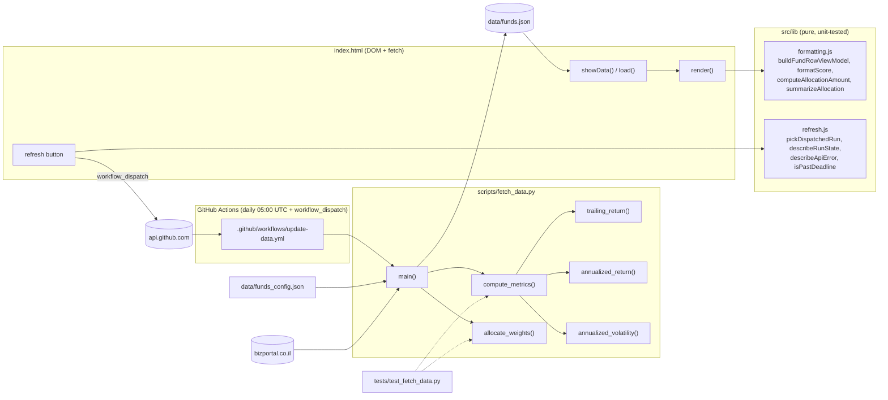

# stockbroker

A small static dashboard for a monthly קרן השתלמות (capital investment fund) deposit:
tracks 7 TASE-listed index funds/ETFs, ranks them by a risk-adjusted score blended
across 1/3/5-year windows (annualized return minus a risk-free rate, ÷ annualized volatility, weighted
25%/35%/40% toward the longer, less noisy windows), and suggests how to split that
month's deposit across them.

Live site: https://hananya-beck.github.io/stockbrokerV2/

## How it works

- `scripts/fetch_data.py` pulls daily NAV history per fund from bizportal.co.il's
  internal chart endpoint and writes `data/funds.json` (trailing returns, volatility,
  risk-adjusted score, suggested weight).
- `.github/workflows/update-data.yml` runs that script daily via GitHub Actions and
  commits the refreshed `data/funds.json`.
- `index.html` is a static page that reads `data/funds.json` and lets you type in a
  deposit amount to see the suggested ₪ split.

## Architecture

Generated from the codebase-memory graph (`get_architecture`: entry points, layers, call boundaries).



## The 7 funds

| Security ID | Name |
|---|---|
| 5141775 | Israel Defense Forces (TA Defense index) |
| 5109889 | TASE 125 |
| 1168723 | Renewable Energy |
| 1159243 | Nasdaq 100 (unhedged, Barclays) |
| 5131081 | Technology TA |
| 5141312 | Banks |
| 5130604 | Infrastructure |

Edit `data/funds_config.json` to add/remove/rename funds.

## Caveats

- Data comes from an undocumented internal endpoint on bizportal.co.il, scraped
  without an official API — it can break if the site changes, and this is a
  gray area relative to their terms of service.
- The repo and site are public, so this fund list is publicly visible.
- This is **not financial advice**. It's a simple momentum/volatility heuristic over
  recent history, not a prediction of future performance. Always sanity-check the
  numbers against the source before acting on them.

## Local dev

```bash
python scripts/fetch_data.py   # regenerates data/funds.json
python -m http.server          # serve index.html locally
```
