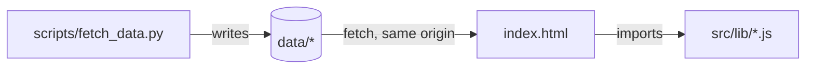
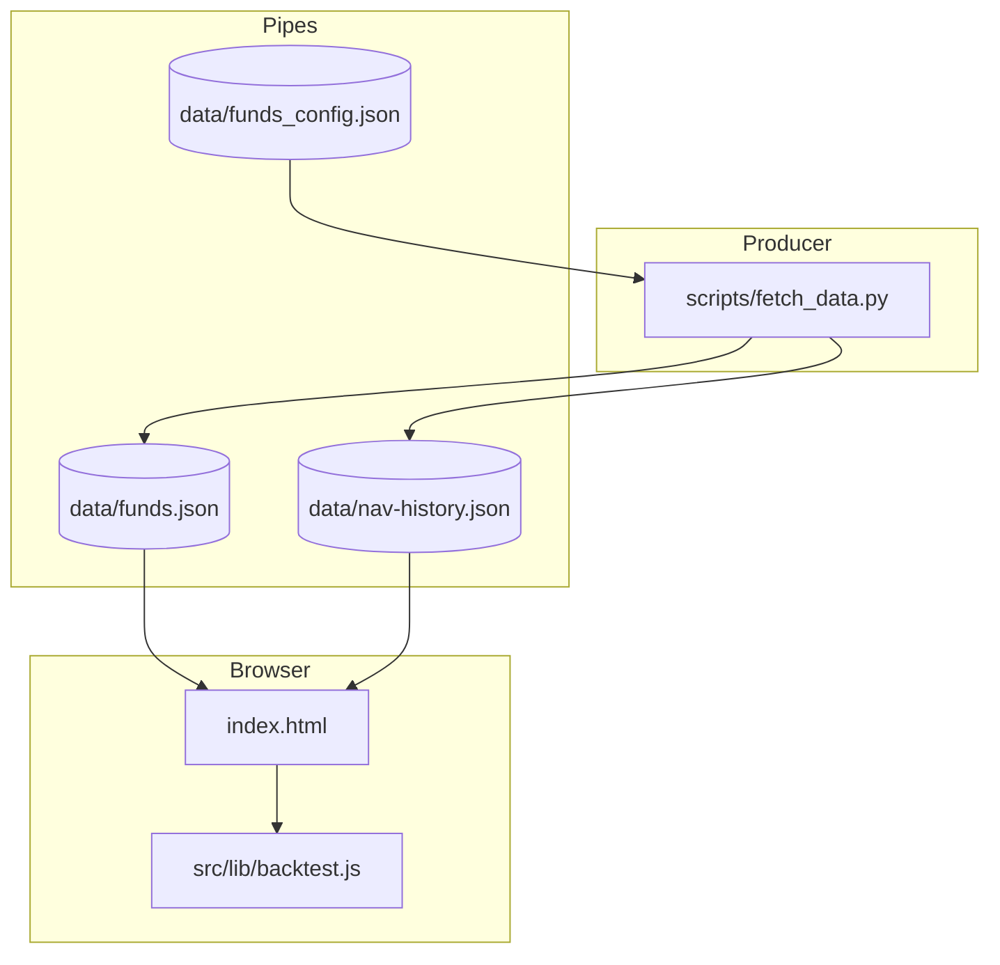

# Architecture Spine — Backtest simulator

## Design Paradigm

Pipes and filters. `scripts/fetch_data.py` is the producer. The `data/*` files are the pipes. The pure modules in `src/lib/` are the filters. `index.html` is the only impure edge, the one place that reads files, reads the clock, touches the DOM, and draws. [ADOPTED: the current repo layout already follows this.]

## Invariants & Rules

### AD-1 — Dependency direction

- **Binds:** all units.
- **Prevents:** the page and the pipeline each re-deriving the same rules, or the page importing producer code.
- **Rule:** `index.html` may import from `src/lib/`. `src/lib/` imports nothing outside itself and never calls `fetch`, touches the DOM, or reads the clock. `index.html` never imports from `scripts/`. The producer and the page share only the files in `data/`.



### AD-2 — Data contract

- **Binds:** FR-6, FR-7, FR-2, FR-4.
- **Prevents:** two readers disagreeing on dates, gap encoding, fund keys, non-numeric values, or who owns the stale flag.
- **Rule:**
  - `data/nav-history.json` is one file: `{ "generated_at": ISO string, "funds": { "<fund id>": { "stale": boolean, "points": [["YYYY-MM-DD", close], ...] } } }`.
  - Fund keys equal the `id`s in `funds.json` exactly. Points are sorted ascending by date. A missing trading day is an absent point, never `null`.
  - `close` is a finite number greater than 0. The producer drops any other value, and serializes with `allow_nan=False`.
  - Every date in any file under `data/` is ISO `YYYY-MM-DD`. This includes `metrics.last_date` in `funds.json`.
  - `stale` is set only by the producer when a fetch fails. `funds.json` and `nav-history.json` carry the same flag for the same id. The page reads the flag and never derives staleness from dates.
  - A successful run merges its points into the stored series by date. A date is never removed by a successful run. When a date is already stored and the source returns a different close, the source value wins.

### AD-3 — Single writer and commit path

- **Binds:** FR-6, FR-7.
- **Prevents:** a history file that is generated but never committed, or `funds.json` committed without its history.
- **Rule:**
  - `scripts/fetch_data.py` is the only code that writes generated files under `data/`. `data/funds_config.json` is the only human-written file under `data/`.
  - Any commit that changes `data/funds.json` also changes `data/nav-history.json`. The workflow and the add-fund skill both stage the two files together, and neither stages `funds.json` alone.
  - The workflow runs `git pull --rebase` before `git push`, and a failed push fails the run.
  - `index.html` never writes to `data/` and never calls bizportal.

### AD-4 — Failure and write safety

- **Binds:** FR-7, FR-6.
- **Prevents:** a run that empties history, a fund that vanishes silently, a half-written pair of files.
- **Rule:**
  - The producer fetches every fund in `funds_config.json` before any write. If zero funds fetch successfully, it writes nothing to either file and exits 1, whether or not previous data exists.
  - A fund whose fetch fails keeps its previous points and is marked `"stale": true`. A fund with no previous data is written with `points: []` and `stale: true`, and the run prints a warning. Every configured fund appears in both files on every successful run.
  - The producer reads the previous `nav-history.json` before fetching. An absent file means no fund has previous points, and that is allowed only on the first run after FR-6. A file that exists but does not parse exits 1 before any write. A failed read never falls back to empty silently.
  - Each file is written to a temp file in `data/` and moved into place with `os.replace`. Both temp files are written before either is moved. `nav-history.json` is moved first, so `funds.json`, which defines the fund list, is the last to change.

### AD-5 — One simulation core

- **Binds:** FR-2, FR-3, FR-4, FR-5.
- **Prevents:** two gap rules, two definitions of a month's deposit price and value, or two readings of where cash goes.
- **Rule:** `src/lib/backtest.js` exports `simulateBacktest(input)`, and nothing else computes portfolio values. Month reduction is fixed here: the deposit is priced at the month's first available NAV, and holdings are valued at its last available NAV. A fund with no NAV in a month has its weight redistributed across the funds that have NAV, in both lines, and its units carry their last known NAV forward. Cash from a month with no NAV for any fund is never invested. It stays in the cumulative value at zero growth through the range end, and the month is listed as a gap month.

### AD-6 — Values and formatting

- **Binds:** FR-5, all display.
- **Prevents:** a percent and a fraction, or a rounded and an unrounded value, reaching the chart from two places.
- **Rule:** cumulative values are ₪ numbers and weights are fractions (`0.196`). Only `src/lib/formatting.js` turns them into text. Unknown values render as `'—'`, never `NaN`. A page that cannot parse `nav-history.json` shows the error next to the run control and disables the run. It never renders partial data.

### AD-7 — Only two browser reads

- **Binds:** FR-5, the NFR that a run makes no network request.
- **Prevents:** a run that depends on anything but the two data files.
- **Rule:** during a backtest the page reads `data/funds.json` (for suggested weights) and `data/nav-history.json`, both relative and both with `cache: 'no-store'` as the page already does. It stores nothing in browser storage.

### AD-8 — Range and floor

- **Binds:** FR-1, FR-2.
- **Prevents:** two pickers with different floors, and a range that depends on the clock inside the core.
- **Rule:** `src/lib/backtest.js` exports `backtestBounds(navHistory, fundIds, nowMonth)`. `index.html` passes `nowMonth` from the browser clock, and the lib never reads it. The floor is the latest of each fund's first month. The range ends at the last complete calendar month before `nowMonth` in which every fund in `fundIds` has at least one point. A stale fund therefore ends the range early, and the page says so next to the control. `index.html` takes both bounds from this function and computes neither.

## Consistency Conventions

| Concern | Convention |
| --- | --- |
| Naming | Files: kebab-case under `data/` (`nav-history.json`). Lib modules: camelCase `.js`, named exports only, one `tests/js/<module>.test.js` each. |
| Data & formats | Dates: ISO `YYYY-MM-DD` everywhere under `data/`. The source's `dd/mm/yyyy` is converted in the producer only. |
| State & cross-cutting | No module-level state in `src/lib`. Every UI string is added to both `STRINGS.he` and `STRINGS.en` in `src/lib/i18n.js`. Failures show next to the control. |

## Stack

| Name | Version |
| --- | --- |
| Python (producer, stdlib only; the workflow runs 3.12) | 3.12 |
| JavaScript (ES modules, no build) | as served by evergreen browsers; checked by TypeScript `checkJs` |
| TypeScript (`checkJs`, dev only) | 5.9.3 (locked; `package.json` range `^5.6.3`) |
| ESLint (dev only) | 9.39.5 (locked; `package.json` range `^9.14.0`) |
| Node (runs `node --test tests/js`) | 20 or later (locally 20.16.0; `node:test` is stable from 18) |
| pytest (`tests/test_fetch_data.py`) | unpinned; no requirements file declares it |

The versions above are what `package-lock.json` resolves today. This spine inherits them and adds nothing. The registry's newest TypeScript and ESLint are outside the declared ranges, so upgrading them would be a separate decision.

## Structural Seed

```text
data/funds_config.json             # human-written fund list
data/funds.json                    # generated; written by fetch_data.py (AD-3, AD-4)
data/nav-history.json              # generated; written by fetch_data.py (AD-2, AD-4)
scripts/fetch_data.py              # producer; writes both generated files
src/lib/backtest.js                # new; simulateBacktest and backtestBounds (AD-5, AD-8)
src/lib/formatting.js              # existing; the only text formatter (AD-6)
tests/js/backtest.test.js          # new
tests/test_fetch_data.py           # extended for the history output
index.html                         # reader and SVG chart
.github/workflows/update-data.yml  # stages both generated files (AD-3)
```



## Capability → Architecture Map

| Capability | Lives in | Governed by |
| --- | --- | --- |
| FR-1 choose inputs | `index.html` controls; bounds from `backtestBounds` | AD-6, AD-8 |
| FR-2 suggested allocation | `src/lib/backtest.js` | AD-5 |
| FR-3 equal-weight baseline | `src/lib/backtest.js` | AD-5 |
| FR-4 missing NAV | `src/lib/backtest.js` | AD-5, AD-2 |
| FR-5 comparison chart | `index.html` (SVG), values from `src/lib/backtest.js` | AD-1, AD-6, AD-7 |
| FR-6 persist history | `scripts/fetch_data.py` | AD-2, AD-3, AD-4 |
| FR-7 store full history, stale data | `scripts/fetch_data.py`, workflow, add-fund skill | AD-2, AD-3, AD-4 |

## Deferred

- Charting library. None is needed for one chart, and adding one would be a runtime dependency. Revisit only if the chart needs interaction that plain SVG can't do.
- Per-fund files or sharding. The history is about 165 KB as one file, so this is not needed now.
- Running the simulation in the producer. The page is the only consumer, and the core is already pure, so moving it would cost more than it saves.

## Follow-ups (code, not in this spine's scope)

These are where the existing code does not yet meet the rules above. They are not implemented in this exercise.

- `main()` in `scripts/fetch_data.py` writes `funds.json` when every fetch fails and some previous data exists. AD-4 requires it to write nothing and exit 1.
- `fetch_data.py` writes with `write_text`, which is not atomic. AD-4 requires temp files and `os.replace`.
- `metrics.last_date` is written as `dd/mm/yyyy`. AD-2 requires ISO.
- `json.dumps` runs without `allow_nan=False`, and the producer's filter lets `0` and `nan` through. AD-2 requires finite values above 0.
- `.claude/skills/add-fund/SKILL.md` commits `funds.json` without `nav-history.json`. AD-3 requires both files in one commit.
- `.github/workflows/update-data.yml` stages only `data/funds.json` and pushes without a rebase. AD-3 requires both files and `git pull --rebase`.
